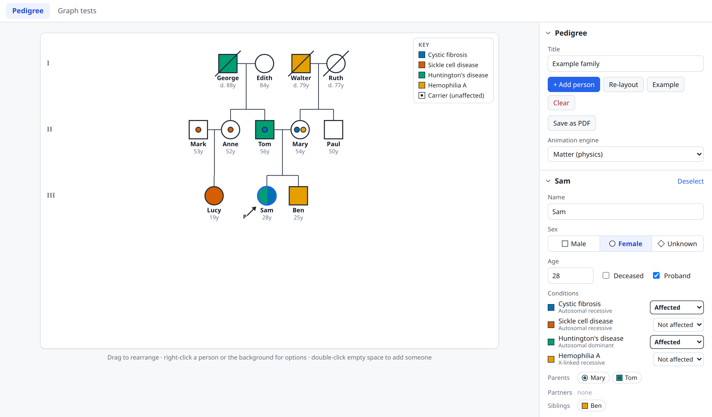
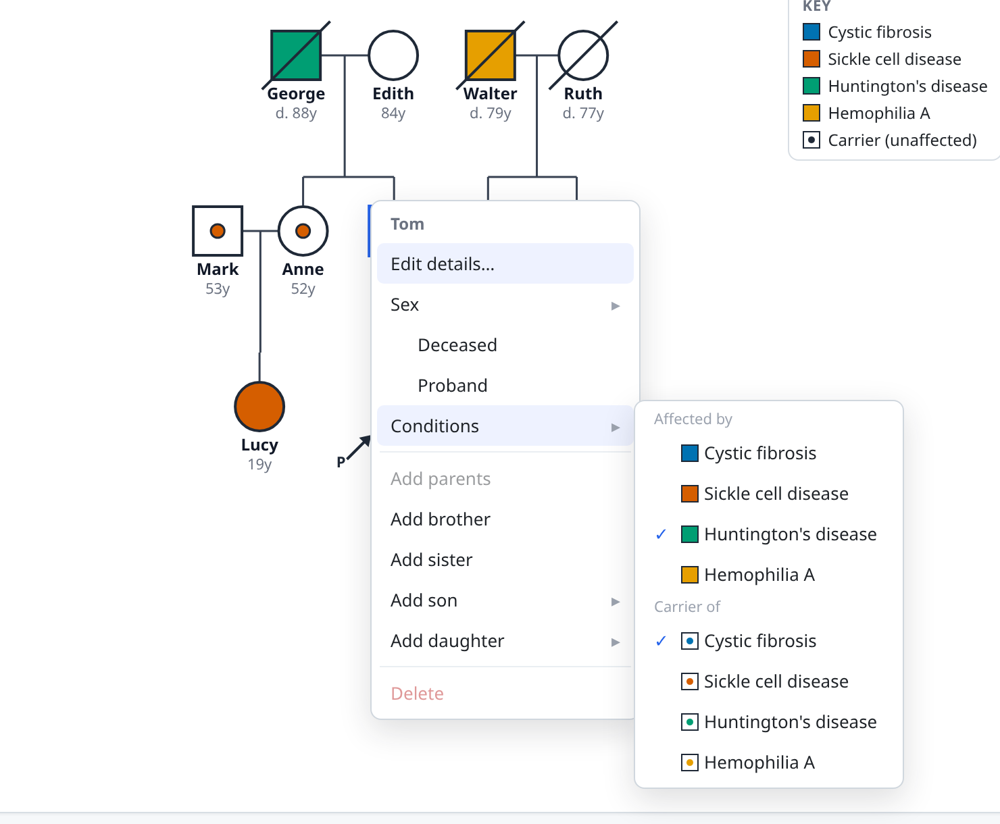
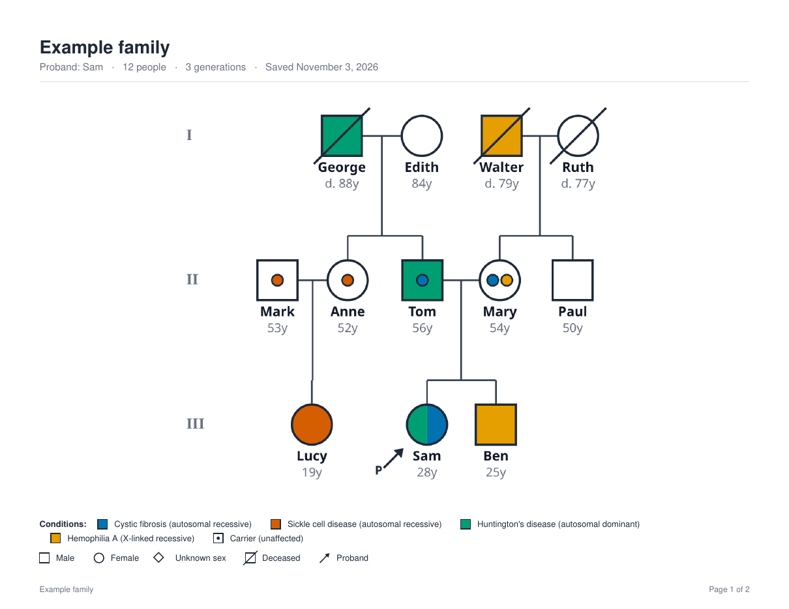
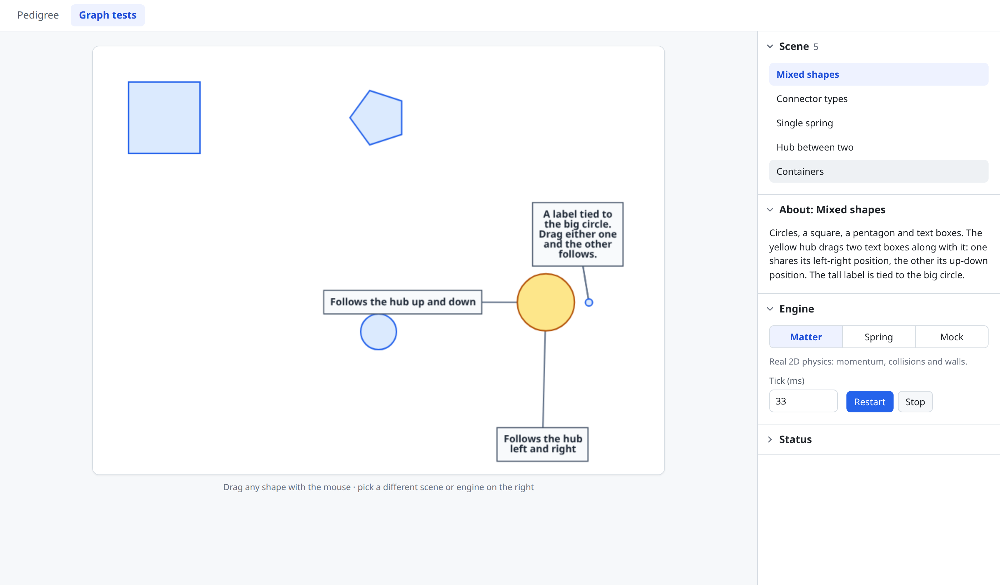
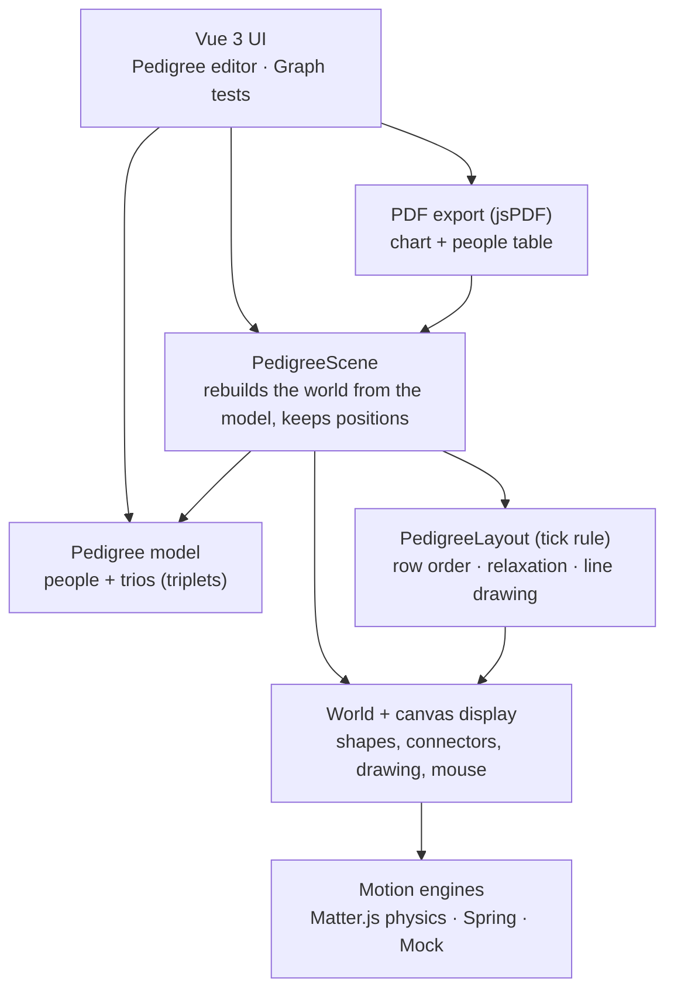

# connectiongraph

**Animated, self-arranging diagrams in TypeScript, with an interactive pedigree (family tree) editor built on top.**

Pedigree charts are how clinical geneticists and researchers follow a disease through a family: squares for
males, circles for females, a slash for someone who has died, an arrow for the person the family history is
centred on (the proband). connectiongraph lets you build one by clicking, and lays it out for you. Generations
line up in rows, partners sit together, each family hangs under its parents, and everything glides into place
as you add relatives.

**[Try the live demo](https://markmckellar.github.io/connectiongraph/)** in your browser; nothing to install.



## What it does

### Pedigree editor

- **Build a family by clicking.** Right-click anyone (or press and hold on a phone) to add parents, a brother or
  sister, or a son or daughter (with an existing partner or a new one). Right-click empty space to add an
  unconnected person.
- **Standard pedigree notation.** Male, female and unknown-sex symbols, deceased slash, proband arrow,
  generation numerals (I, II, III...), partner lines and sibship lines.
- **Automatic layout that stays out of your way.** Rows are ordered so partners are adjacent, siblings stay
  together and each family sits under its parents; someone who married in goes on the outside so they never
  split their partner's siblings. Drag people to rearrange, or press **Re-layout** to tidy everything.
- **Genetic conditions and carriers.** Mark people as affected by, or carriers of, cystic fibrosis, sickle cell
  disease, Huntington's disease or hemophilia A. Affected symbols are filled in each condition's colour (split
  when someone has more than one), carriers get the standard centre dot, and a key lists what's in use. The
  example family shows all three inheritance patterns: dominant, recessive and X-linked.
- **Person details.** Name, sex, age, deceased, proband and conditions, edited in the sidebar, with each
  person's parents, partners, siblings and children one click away.
- **Save as PDF.** A print-ready chart with title, summary, conditions key and symbol legend, followed by a table
  of everyone (generation, name, sex, age, status, conditions, parents). [See an example](docs/example-pedigree.pdf).
- **Plain data underneath.** Export and import the whole pedigree as JSON.
- **Works on desktop and phone.** Sharp on high-resolution screens; the chart scales to fit a phone.





### The graph library

Underneath is a small framework for animated diagrams of connected shapes:

- **Pluggable motion engines.** The same scene runs on real 2D physics ([Matter.js](https://brm.io/matter-js/)),
  on a lightweight spring model, or with no physics at all. Pick one at runtime.
- **Connectors with rules.** Join shapes with connectors that keep a distance, share an x or y position,
  centre a hub between neighbours, or hang one shape below another.
- **Containers and area rules.** Keep a group of shapes in a tidy row inside a box that moves as one unit and
  resizes to fit, or let members spread apart without overlapping.
- **Tick rules.** Any object that implements `processAllRules()` runs every engine tick. The pedigree layout is
  one of these.
- **Drag anything.** Mouse interaction works the same across engines.

The **Graph tests** tab shows these building blocks in small scenes you can drag around and switch between
engines.



## How the pedigree works

**The data model is a list of people plus "triplets"** (trios), each one a child with their mother and father:

```json
{
  "title": "Example family",
  "people": [
    { "id": "p1", "name": "George", "sex": "male",   "age": 88, "deceased": true,  "conditions": ["hd"] },
    { "id": "p2", "name": "Edith",  "sex": "female", "age": 84, "deceased": false, "conditions": [] },
    { "id": "p5", "name": "Tom",    "sex": "male",   "age": 56, "deceased": false, "conditions": ["hd"],
      "carrierOf": ["cf"] }
  ],
  "trios": [
    { "childId": "p5", "motherId": "p2", "fatherId": "p1" }
  ]
}
```

Each person lists the conditions they're affected by and those they carry. Everything else is derived from
the trios: couples, sibships, half-siblings (the same parent with different
partners) and each person's generation. Generations are found by pushing children below their lower parent and
keeping partners on the same row until nothing changes.

**Layout happens in two layers:**

1. **Row ordering.** A layered-graph pass orders each generation, sweeping down and up the rows and sorting by
   the average position of each person's parents (or children). Partners move together as a block. This
   decides who sits next to whom.
2. **Continuous relaxation.** A tick rule runs every frame and nudges people toward that arrangement: each row
   to its height, partners side by side, siblings packed, sibships centred under their parents, and nobody
   overlapping, with room left for name labels. Because it runs live, the chart animates smoothly after every
   edit, and a person you're dragging is left under your mouse.

For the PDF, the same rules are run to completion off-screen, without the canvas edges. The saved chart is the
fully settled layout even if it's mid-animation or wider than the screen.

## Architecture



The library (`source/connectiongraph`) is plain, framework-free TypeScript; Vue is only the user interface.

## Tech

TypeScript (strict) · Vue 3 (`<script setup>`) · Vite · HTML canvas · Matter.js · jsPDF

## Run it

Needs Node 20 or newer (`nvm use` picks up `.nvmrc`).

```sh
npm install
npm run dev        # http://localhost:5173
```

| Command | What it does |
| --- | --- |
| `npm run dev` | Start the app with live reload |
| `npm run build` | Type-check and build a static site into `dist/` |
| `npm run preview` | Serve the built site |
| `npm run typecheck` | Type-check only |

The built site is static files only, so it can be hosted anywhere. The live demo is built and published to
GitHub Pages automatically on every push to `master` (`.github/workflows/pages.yml`).

## Project layout

```
source/
  connectiongraph/        the graph library (framework-free TypeScript)
    engine/               motion engines, connectors and positioners, area rules, tick rules
    display/              canvas drawing for shapes, text and connectors
    world/                world objects, positions, and the demo scenes (world/tests)
  pedigree/
    pedigree.ts           the data model: people + trios
    scene/                layout, row ordering, pedigree symbols, the scene
    export/               PDF export
src/                      the Vue app (App.vue, components/)
docs/                     screenshots and an example PDF
```

## History

I started connectiongraph in 2018 to experiment with self-arranging, animated diagrams on an HTML canvas, with
pedigree charts as the main goal. I've built pedigree software professionally, for cancer research and variant
classification in a clinical genetics lab, and wanted a lighter, browser-based take on the same idea.

In 2026 I brought it up to date with the help of [Claude Code](https://claude.com/claude-code):

- **Modern tooling.** Moved from gulp and browserify to Vite, Vue 3 and strict TypeScript, and upgraded Matter.js
  from 0.13 to 0.20.
- **Engine fixes.** Fixed several engine bugs along the way, including a physics body that was stepped twice per
  frame and layouts that drifted instead of settling.
- **New features.** Added the pedigree editor, its layout, and PDF export.

## License

MIT, see [LICENSE](LICENSE).
